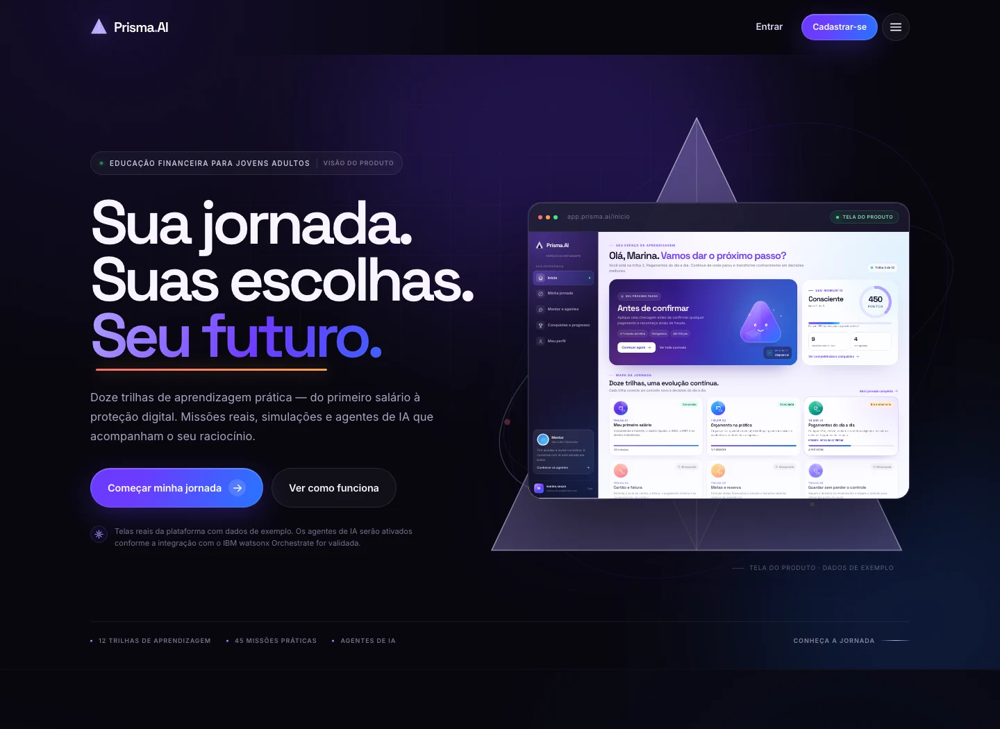
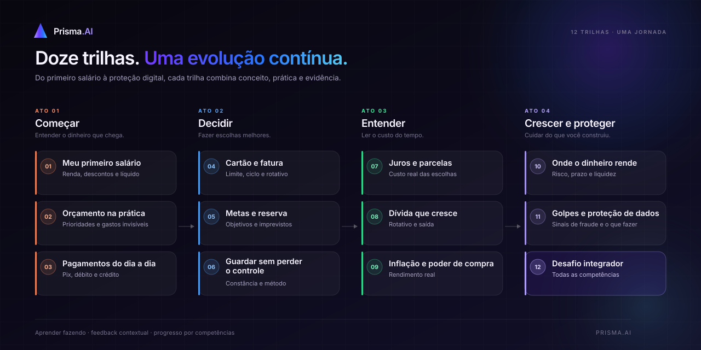
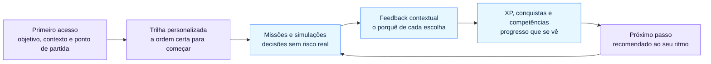
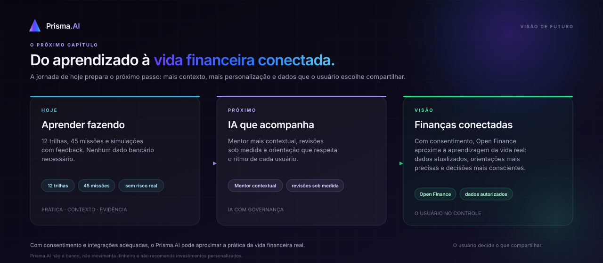

  

<h1 align="center">Prisma.AI</h1>

  <strong>Sua jornada. Suas escolhas. Seu futuro.</strong>

  Educação financeira para jovens adultos que aprendem fazendo: 
  12 trilhas, 45 missões e uma experiência que transforma decisões do dia a dia em autonomia.

  <a href="#o-que-é-o-prismaai">A ideia</a> ·
  <a href="#por-que-isso-importa-para-os-jovens">Por que importa</a> ·
  <a href="#a-experiência">A experiência</a> ·
  <a href="#a-inteligência">A inteligência</a> ·
  <a href="#visão-de-futuro">Visão de futuro</a>

---

## O que é o Prisma.AI

**O dinheiro chega antes da educação financeira.**

O primeiro salário, o primeiro cartão, o primeiro Pix, a primeira parcela. As decisões financeiras aparecem cedo — muitas vezes antes de alguém ter tido a chance de praticá-las.

O Prisma.AI parte de uma convicção simples: **educação financeira não se aprende só lendo. Aprende-se decidindo.** Por isso, transforma situações cotidianas em missões e simulações, com feedback que explica o porquê de cada escolha.

> **Em uma frase:** o Prisma.AI é uma plataforma de educação financeira para jovens adultos que querem aprender fazendo — do primeiro salário à proteção digital, no seu contexto e no seu ritmo.

O Prisma.AI foi desenhado para jovens adultos, especialmente entre 18 e 24 anos, que estão começando a decidir sobre o próprio dinheiro — em diferentes níveis de conhecimento e familiaridade digital. Nenhum dado bancário é necessário para começar, e nenhuma transação real é executada.

**Três escolhas definem a experiência:**

| Princípio | O que muda para o usuário |
|:---|:---|
| **Praticar antes da teoria** | Missões e simulações colocam os usuários diante de escolhas concretas, com consequências seguras. |
| **Aprender no próprio contexto** | O primeiro acesso considera objetivos, nível e momento de vida para sugerir por onde começar. |
| **Enxergar o progresso** | XP, conquistas e competências mostram o que foi aprendido — não apenas o tempo passado na tela. |

---

## Por que isso importa para os jovens

**A primeira conta chega antes da primeira aula de educação financeira.**

| <h3 align="center">20 anos</h3> | <h3 align="center">27,6 milhões</h3> | <h3 align="center">3,3% vs. 2,1%</h3> |
|:---:|:---:|:---:|
| era a idade média do primeiro relacionamento com o sistema financeiro em 2024 — eram cerca de 35 anos em 2020. | de jovens de 15 a 29 anos tinham acesso a crédito em 2024, mais que o dobro de 2016 (13,7 milhões). | inadimplência média de jovens e adultos nos últimos oito anos — mais de 50% maior para os jovens. |

**Fontes:** [BCB, Relatório de Cidadania Financeira 2025, seção 2.3](https://www.bcb.gov.br/content/cidadaniafinanceira/documentos_cidadania/RCF/relatorio_de_cidadania_financeira_2025.pdf) · [Metrópoles, 13/04/2026](https://www.metropoles.com/brasil/jovens-tem-inadimplencia-50-superior-a-de-adultos-aponta-bc) · [BCB, Relatório de Letramento Financeiro 2023](https://www.bcb.gov.br/content/cidadaniafinanceira/documentos_cidadania/letramento/relatorio-de-letramento-financeiro.pdf).

O cartão é a porta de entrada: **13 milhões** de jovens usaram o rotativo ou o parcelado em 2024 — 79% dos 17 milhões que usaram cartão. Entre jovens de baixa renda (até 2 salários mínimos), **17,4% estavam inadimplentes**. No país, **83,9 milhões** de pessoas estavam inadimplentes em julho de 2026, com **R$ 586,4 bilhões** em dívidas ([Serasa](https://www.serasa.com.br/imprensa/inadimplencia-segundo-semestre-serasa/)).

### O paradoxo que explica o Prisma.AI

Na pesquisa de letramento do Banco Central, jovens de 16 a 24 anos tiraram **64,5**, acima da média nacional de **59,6** ([BCB/OCDE, 2023](https://www.bcb.gov.br/content/cidadaniafinanceira/documentos_cidadania/letramento/relatorio-de-letramento-financeiro.pdf)). Na análise de crédito, porém, jovens de 15 a 29 anos têm inadimplência maior que adultos.

> **Saber não é o mesmo que praticar.**

É essa distância que o Prisma.AI transforma em jornada. Quando o primeiro cartão, o primeiro limite e a primeira parcela chegam, o usuário precisa de um lugar seguro para praticar — antes que o erro custe caro.

Faixas etárias: letramento, 16 a 24 anos; crédito, 15 a 29 anos (Estatuto da Juventude).

<strong>Para ir além:</strong> <a href="https://exame.com/invest/minhas-financas/numero-de-jovens-com-acesso-a-credito-dobra-no-brasil-em-oito-anos/">Exame, out/2026 — crédito entre jovens dobra em oito anos</a> · <a href="https://www.estadao.com.br/einvestidor/financas-pessoais/geracao-z-cartao-de-credito-endividamento/">Estadão, dez/2025 — Geração Z lidera pedidos de cartão</a>.

**O impacto que queremos ver:** quando um usuário reconhece o custo real de uma parcela antes de assinar — ou identifica um golpe antes de clicar — a educação financeira deixa de ser conteúdo e vira proteção. É esse impacto que o Prisma.AI quer tornar cotidiano.

---

## A experiência

A porta de entrada do Prisma.AI: uma promessa simples, uma jornada visual e nenhum dado bancário necessário. Telas com dados de exemplo.

**A jornada começa onde a vida financeira começa:** no primeiro salário, no primeiro cartão, no primeiro limite.

### Doze trilhas, quatro movimentos

Do primeiro salário à proteção digital, as trilhas avançam por quatro movimentos: **começar, decidir, entender e crescer e proteger**. Cada uma combina conceito, prática e evidência — e a ordem pode ser personalizada para o momento do usuário.

As trilhas cobrem salário, orçamento, pagamentos, cartão, metas, reserva, juros, dívidas, inflação, investimentos, golpes e um desafio integrador.

| O que o usuário encontra | Como isso acontece |
|:---|:---|
| **Missões que pedem decisão** | Cenários, simulações e atividades em que o usuário escolhe, recebe feedback e ajusta o raciocínio — sem risco financeiro real. |
| **Feedback que explica o porquê** | Cada resposta ganha contexto: não só o que estava certo, mas o raciocínio por trás da escolha. |
| **Trilha que parte do usuário** | Objetivo, nível e momento de vida ajudam a definir por onde começar. A ordem pode ser personalizada. |
| **Progresso que se vê** | XP, níveis, conquistas e competências transformam aprendizagem em marcos concretos. |

**Prismas (◆)** são a moeda da jornada. Cada acerto e conclusão rende Prismas, que dão acesso ao Estúdio de Prismas — o espaço onde a revisão vira parte do aprendizado. A economia já faz parte da experiência; a geração de revisões, flashcards e exercícios com IA é o próximo passo. Não há compra de Prismas nem ranking público: a moeda é conquistada aprendendo.

### Como a jornada funciona

O ciclo se repete: cada próximo passo nasce do que o usuário demonstrou saber.

---

## A inteligência

O Prisma.AI foi desenhado para ser mais do que um curso com telas bonitas. A camada de agentes foi criada para acompanhar o raciocínio do usuário — e para tornar a orientação mais próxima a cada passo.

| Agente | O que faz | Hoje |
|:---|:---|:---|
| **Catalisador** | Personaliza a ordem das trilhas e sugere o próximo passo. | Regras claras, já em uso. |
| **Mentor** | Acompanha o raciocínio durante as missões e abre espaço para dúvidas sobre os conceitos. | Interface, contexto e histórico prontos; a IA generativa está em evolução. |
| **Analista** | Lê evidências, identifica dificuldades recorrentes e recomenda reforço. | Insights com regras claras, já em uso. |

> **A IA orienta. As regras decidem.**
>
> Nenhum agente concede pontos, cria conquistas ou desbloqueia trilhas. O progresso é consequência do que o usuário demonstra saber — uma escolha de produto que protege a confiança na jornada.

Com a ativação da IA generativa, o Mentor poderá responder de forma mais contextual, o Analista poderá cruzar mais evidências e o Estúdio poderá criar revisões, flashcards e exercícios sob medida.

---

## Visão de futuro

Hoje: prática sem dados bancários. Próximo: uma IA mais contextual. Visão: Open Finance com consentimento.

O próximo capítulo do Prisma.AI é aproximar a prática da vida financeira real — sem abrir mão do que torna a experiência segura: **consentimento, contexto e limites claros**.

Para uma geração que começa a usar crédito por volta dos 20 anos, a orientação precisa chegar antes da fatura — não depois.

### Open Finance, com consentimento

O **[Open Finance](https://www.bcb.gov.br/estabilidadefinanceira/openfinance)** é o sistema financeiro aberto regulado pelo Banco Central. Com autorização, o usuário pode compartilhar dados financeiros reais entre instituições e ter uma visão mais completa da própria vida financeira — e revogar esse acesso quando quiser.

**208,79 milhões** de consentimentos ativos — autorizações de compartilhamento de dados — no Open Finance Brasil em 31 de julho de 2026 ([Open Finance Brasil, dashboard oficial](https://dashboard.openfinancebrasil.org.br/transactional-data/active-consents/receivers)). O ecossistema já existe em escala. O Prisma.AI quer usar essa infraestrutura para transformar dados autorizados em contexto de aprendizagem — não em vigilância.

| Hoje | Com Open Finance (visão) |
|:---|:---|
| Praticar com cenários fictícios e exemplos. | Praticar com situações autorizadas e atualizadas do próprio usuário. |
| Trilha personalizada pelo primeiro acesso. | Trilha que pode se ajustar a mudanças de renda, gastos e objetivos. |
| Revisões e feedback com base no desempenho. | Orientações mais contextuais, oportunas e conectadas ao momento. |

Com essa camada, o Prisma.AI pode oferecer análises mais contextualizadas, orientações que acompanham o momento do usuário e revisões mais alinhadas ao que ele está vivendo. Na prática, isso pode significar uma revisão sobre juros quando a fatura cresce, ou uma simulação de reserva quando um objetivo muda de ritmo.

Tudo isso com consentimento explícito, possibilidade de revogação e integrações adequadas. O usuário decide o que compartilhar — e o que manter fora da jornada.

**O que não muda:** o Prisma.AI não é banco, não movimenta dinheiro e não recomenda investimentos personalizados. A proposta é educacional: dar contexto para que o usuário faça escolhas mais conscientes, hoje e quando a vida financeira ficar mais complexa.

### A visão

Imagine o primeiro salário de um usuário. Em vez de uma planilha genérica, ele encontra uma trilha que conversa com o seu momento; uma simulação que parte do seu orçamento; e um Mentor que explica o custo real de uma parcela antes da decisão.

Essa é a direção: uma plataforma cada vez mais **inteligente, conectada e útil** — que se adapta ao percurso do usuário, com consentimento, para tornar o próximo passo mais claro.

> **Educação financeira não deveria começar quando a dívida chega. Deveria começar quando a primeira escolha aparece.**
>
> O Prisma.AI existe para que o próximo passo financeiro seja uma escolha, não uma surpresa.

---

  Para mergulhar na visão completa, explore a <a href="docs/Conteudo_e_Jornada_de_Aprendizagem.md">jornada de aprendizagem</a>, o <a href="docs/CONTRATO_CURRICULAR_12_TRILHAS.md">contrato curricular das 12 trilhas</a> e o <a href="docs/trilhas/INDICE_TRILHAS.md">índice das trilhas</a>.

  <strong>Prisma.AI</strong> 
  Aprender finanças é praticar o próximo passo.

