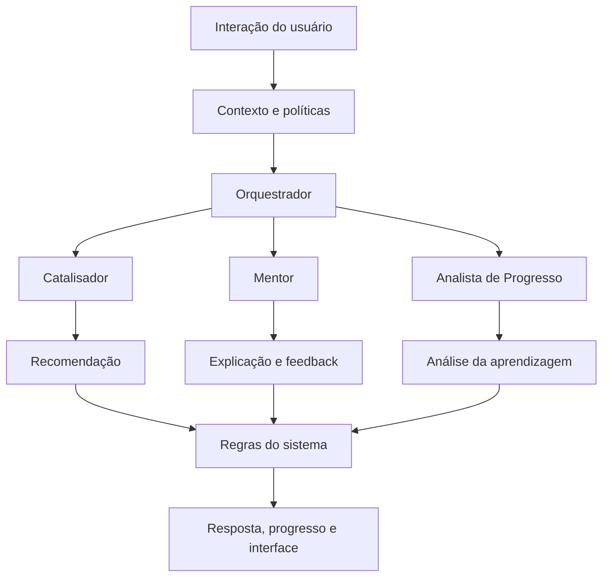

# PRD — ELL IBM

**Documento de Requisitos do Produto**  
**Versão:** 1.1
**Status:** Atualizado com decisões confirmadas em sessão de alinhamento (D1–D9)
**Plataforma:** Aplicação web responsiva, mobile-first
**Público principal:** Jovens adultos, com faixa de 18 a 24 anos como premissa de trabalho
**Escopo:** MVP iterativo por trilha — piloto começa com a Trilha 1 (Meu primeiro salário)

---

## 1. Resumo executivo

O ELL IBM é uma plataforma web de educação financeira gamificada, destinada a jovens adultos, com foco no desenvolvimento da autonomia financeira por meio de experiências interativas, simulações e inteligência artificial contextual.

O produto combina aprendizagem estruturada, personalização, avaliação híbrida e gamificação imersiva. A IA estará presente ao longo da experiência por meio de dois agentes especializados (Mentor e Analista de Progresso), coordenados pelo watsonx Orchestrate, e uma camada de lógica determinística (Catalisador) no backend.

> **Decisão confirmada (D2):** o MVP é iterativo por trilha. O piloto começa com a Trilha 1 completa (onboarding + 3 missões + simulação). A expansão para as trilhas seguintes depende dos resultados de cada piloto.

A primeira versão priorizará interações por texto (respostas estruturadas, texto aberto e chat). Áudio foi formalmente adiado para versão posterior (D3).

**Proposta de valor:** transformar a educação financeira em uma jornada prática, personalizada, segura e motivadora, na qual o usuário aprende a tomar decisões melhores por meio de escolhas e consequências simuladas.

### Convenção de leitura

- **Confirmado:** decisão aprovada durante a definição do produto.
- **Proposta:** requisito recomendado para tornar a visão implementável.
- **Pendente:** questão que exige validação antes do desenvolvimento ou lançamento.

## 2. Visão, problema e objetivos

### 2.1 Visão do produto

> Sua jornada. Suas escolhas. Seu futuro.

O ELL IBM pretende ajudar o usuário a desenvolver conhecimento e confiança para lidar com situações financeiras cotidianas, compreender produtos financeiros, organizar seus recursos e reconhecer riscos e golpes.

### 2.2 Problema a resolver

A proposta parte da hipótese de que conteúdos financeiros tradicionais podem ser pouco envolventes ou difíceis de relacionar às decisões reais dos jovens. O produto buscará aproximar o aprendizado da prática por meio de desafios, cenários interativos e feedback contextual.

**Pendente:** validar essa hipótese com pesquisa de usuários e evidências sobre as necessidades específicas do público.

### 2.3 Objetivos do produto

1. Ensinar conceitos fundamentais de educação financeira.
2. Desenvolver hábitos mais conscientes de planejamento e controle financeiro.
3. Ajudar a compreender crédito, parcelamento, juros e endividamento.
4. Promover a identificação e a prevenção de golpes financeiros e digitais.
5. Adaptar a experiência aos objetivos, às respostas e ao progresso do usuário.
6. Aumentar o envolvimento com o aprendizado por meio de uma experiência gamificada.
7. Medir a evolução do conhecimento, não apenas a participação na plataforma.

### 2.4 O que não constitui objetivo do MVP

- Executar transações financeiras.
- Conectar contas bancárias ou importar extratos.
- Atuar como consultor financeiro pessoal.
- Recomendar investimentos personalizados.
- Competir publicamente em rankings.
- Substituir profissionais ou canais oficiais em situações complexas.

## 3. Público-alvo e contexto de uso

**Público principal:** jovens adultos de 18 a 24 anos, conforme a premissa adotada no planejamento inicial.

A experiência deve considerar usuários com diferentes níveis de conhecimento financeiro, familiaridade digital, disponibilidade de tempo e objetivos pessoais.

### 3.1 Necessidades que o produto deverá atender

- Entender conceitos financeiros sem depender de linguagem excessivamente técnica.
- Praticar decisões sem sofrer consequências financeiras reais.
- Receber explicações adaptadas às próprias dúvidas.
- Acompanhar a evolução de forma visual e compreensível.
- Aprender a identificar situações de risco.
- Escolher entre digitar, responder a atividades ou falar por áudio.

**Pendências:** confirmar perfis prioritários, necessidades por segmento, requisitos de acessibilidade, idiomas e condições de conectividade.

## 4. Princípios de experiência

1. **Aprender fazendo:** o usuário pratica por meio de decisões, desafios e simulações, em vez de depender exclusivamente de leitura.
2. **IA presente e contextual:** os agentes contribuem em momentos relevantes, sem exigir IA para cada interação simples.
3. **Imersão com propósito:** narrativa, animações e recompensas reforçam a aprendizagem, sem competir com ela.
4. **Segurança e autonomia:** o usuário mantém controle sobre suas interações, enquanto o sistema protege dados e limita ações autônomas.
5. **Mobile-first:** navegação, leitura, atividades, chat e áudio funcionam bem em telas pequenas, sem exigir uma aplicação nativa.

## 5. Jornada de aprendizagem

> **Decisão confirmada (D1 — revisada):** a jornada é estruturada em **doze trilhas progressivas**, precedidas por onboarding obrigatório. Os nomes e o conteúdo das trilhas seguem o Contrato Curricular em `docs/CONTRATO_CURRICULAR_TRILHAS.md`. A estrutura anterior de seis fases foi substituída pela reestruturação curricular documentada na migration `0015_twelve_trails.py`.

Cada trilha reúne objetivos de aprendizagem, missões, simulações, intervenções dos agentes e critérios de conclusão por competências demonstradas. A trilha 12 (Desafio integrador) é sempre a última e avalia a aplicação conjunta de todas as competências anteriores.

### Trilha 1 — Meu primeiro salário

Compreender renda bruta e líquida, holerite, descontos legais e direitos trabalhistas.

**Resultado esperado:** o usuário interpreta contracheques fictícios, calcula o líquido a partir do bruto e identifica INSS, IRRF, FGTS e benefícios.

### Trilha 2 — Orçamento na prática

Organizar o orçamento mensal, classificar despesas, identificar gastos invisíveis e propor ajustes realistas.

**Resultado esperado:** o usuário elabora um orçamento coerente, identifica desvios e propõe ajustes sem comprometer necessidades essenciais.

### Trilha 3 — Pagamentos do dia a dia

Compreender Pix, débito, crédito, carteiras digitais e escolher o meio adequado para cada situação.

**Resultado esperado:** o usuário compara meios de pagamento e aplica um procedimento de conferência antes de confirmar.

### Trilha 4 — Cartão e fatura

Entender limite, ciclo de faturamento, pagamento integral, pagamento mínimo e crédito rotativo.

**Resultado esperado:** o usuário calcula o comprometimento futuro da renda com parcelas em aberto e compara cenários de pagamento.

### Trilha 5 — Metas e reserva

Formular metas financeiras e calcular o tamanho da reserva de emergência com base no perfil de renda.

**Resultado esperado:** o usuário dimensiona e planeja a constituição de uma reserva de emergência adequada ao seu perfil.

### Trilha 6 — Guardar sem perder o controle

Aplicar a estratégia de separação do dinheiro no recebimento e adaptar o método para diferentes perfis de renda.

**Resultado esperado:** o usuário configura transferências programadas e aplica o método de pagar-se primeiro.

### Trilha 7 — Juros e parcelas

Compreender juros simples e compostos, custo efetivo total (CET) e avaliar ofertas de parcelamento.

**Resultado esperado:** o usuário calcula o custo total de uma oferta de crédito e compara alternativas usando o CET.

### Trilha 8 — Dívida que cresce

Interpretar o crescimento de dívidas, calcular o impacto do crédito rotativo e traçar estratégias de saída.

**Resultado esperado:** o usuário calcula cenários de pagamento mínimo, compara alternativas e avalia propostas de renegociação.

### Trilha 9 — Inflação e poder de compra

Compreender o IPCA, calcular reajustes e diferenciar rendimento nominal de real.

**Resultado esperado:** o usuário aplica a fórmula de rendimento real e interpreta o impacto da inflação no poder de compra.

### Trilha 10 — Onde o dinheiro rende

Compreender fundamentos da renda fixa, FGC, tributação e comparar produtos.

**Resultado esperado:** o usuário diferencia produtos cobertos pelo FGC, reconhece custos e compara rentabilidade real de alternativas.

### Trilha 11 — Golpes e proteção de dados

Reconhecer fraudes digitais, proteger dados e agir corretamente após um golpe.

**Resultado esperado:** o usuário identifica sinais de fraude, conhece o MED e descreve os procedimentos pós-golpe.

### Trilha 12 — Desafio integrador

Aplicar competências de todas as trilhas anteriores em cenários integrados de decisão financeira.

**Resultado esperado:** o usuário toma decisões coerentes em cenários que combinam salário, orçamento, pagamentos, crédito, reserva, investimentos e segurança.

### 5.1 Requisitos da jornada

- **RF-01:** apresentar as trilhas em um mapa visual de progresso.
- **RF-02:** associar cada trilha a objetivos de aprendizagem definidos.
- **RF-03:** oferecer conteúdo e atividades compatíveis com a trilha atual.
- **RF-04:** apresentar feedback após respostas e decisões relevantes.
- **RF-05:** permitir revisão de conceitos e repetição de desafios.
- **RF-06:** controlar a conclusão e os desbloqueios por critérios objetivos.
- **RF-07:** registrar o progresso para permitir continuidade entre sessões.

A quantidade de atividades por trilha e os critérios detalhados de domínio ainda serão especificados.

## 6. Requisitos funcionais

Os requisitos a seguir transformam as decisões aprovadas em comportamentos que o produto deverá oferecer.

### 6.1 Onboarding e diagnóstico

- **RF-08:** apresentar a proposta de valor, o funcionamento da jornada e os limites da IA.
- **RF-09:** coletar os objetivos e interesses relevantes à personalização.
- **RF-10:** oferecer um diagnóstico inicial de conhecimentos e hábitos declarados.
- **RF-11:** utilizar o diagnóstico para definir recomendações iniciais, sem rotular ou constranger o usuário.
- **RF-12:** explicar a finalidade da coleta de dados e solicitar os consentimentos aplicáveis.

### 6.2 Conteúdo educacional

- **RF-13:** apresentar conteúdo financeiro em formatos adequados à web móvel.
- **RF-14:** relacionar cada conteúdo a objetivos de aprendizagem.
- **RF-15:** utilizar materiais revisados por responsáveis definidos pelo projeto.
- **RF-16:** oferecer exemplos práticos, cenários e explicações alternativas.
- **RF-17:** manter controle de versão dos conteúdos e de suas respectivas fontes.

### 6.3 Interações com o usuário

- **RF-18:** suportar questões de múltipla escolha e respostas estruturadas.
- **RF-19:** permitir respostas abertas por texto.
- **RF-20:** permitir envio de respostas por áudio, mediante captura e processamento de voz.
- **RF-21:** disponibilizar chat livre com o Mentor dentro dos limites educacionais definidos.
- **RF-22:** oferecer feedback contextual nas modalidades suportadas.
- **RF-23:** permitir que o usuário encerre, ignore ou retome uma sugestão do agente.
- **RF-24:** preservar o contexto relevante de uma atividade durante a interação, conforme as regras de privacidade.

### 6.4 Personalização

- **RF-25:** utilizar objetivos e interesses para selecionar recomendações pertinentes.
- **RF-26:** utilizar o diagnóstico para ajustar o ponto de partida.
- **RF-27:** utilizar respostas e erros para identificar possíveis lacunas de aprendizagem.
- **RF-28:** utilizar o progresso para sugerir revisões e novos desafios.
- **RF-29:** permitir que o sistema aplique regras de adaptação previamente definidas.
- **RF-30:** evitar que uma resposta isolada ou ambígua seja tratada automaticamente como evidência definitiva de desconhecimento.

### 6.5 Avaliação

- **RF-31:** avaliar respostas objetivas com critérios determinísticos.
- **RF-32:** utilizar a IA para interpretar respostas abertas segundo critérios educacionais documentados.
- **RF-33:** solicitar esclarecimentos quando a resposta não puder ser interpretada com segurança.
- **RF-34:** distinguir avaliação de aprendizagem, recomendação pedagógica e pontuação de gamificação.
- **RF-35:** manter os desbloqueios de trilhas sob controle do sistema.
- **RF-36:** permitir revisão e nova tentativa de atividades, conforme as regras de cada missão.

### 6.6 Gamificação e progresso

- **RF-37:** conceder pontos conforme regras explícitas.
- **RF-38:** disponibilizar níveis, conquistas e marcos de evolução.
- **RF-39:** apresentar missões e desafios ligados aos objetivos educacionais.
- **RF-40:** disponibilizar simulações com consequências educativas.
- **RF-41:** desbloquear elementos digitais e conteúdos conforme critérios definidos.
- **RF-42:** apresentar painel individual de progresso e competências.
- **RF-43:** não oferecer ranking público no MVP.
- **RF-44:** impedir que a IA altere diretamente a pontuação ou conceda desbloqueios fora das regras.

### 6.7 Orquestração dos agentes

> **Decisão confirmada (D4):** o MVP opera com dois agentes de IA (Mentor e Analista de Progresso) e uma camada determinística (Catalisador no backend). O Catalisador não usa IA no MVP.

- **RF-45:** o backend decide quando invocar cada agente com base no contexto da interação.
- **RF-46:** o Mentor é invocado em tempo real; o Analista opera em background após respostas relevantes.
- **RF-47:** o Catalisador executa recomendações de próximo passo e concessão de pontos/conquistas por regras determinísticas.
- **RF-48:** aplicar políticas de segurança comuns a todos os agentes (ver Documento 4, Decisão 8).
- **RF-49:** registrar eventos técnicos relevantes para monitoramento, respeitando a política de privacidade.
- **RF-50:** oferecer conteúdo educacional estático como fallback quando o serviço de IA estiver indisponível; o progresso do usuário não deve ser afetado.

## 7. Especificação dos agentes de IA

### 7.1 Catalisador — Agente de Personalização

**Responsabilidade:** recomendar a experiência mais adequada ao contexto educacional do usuário.

**Entradas permitidas:**
- Objetivos e interesses declarados.
- Diagnóstico inicial.
- Respostas e dificuldades identificadas.
- Progresso e atividades concluídas.

**Saídas esperadas:**
- Sugestões de conteúdo.
- Recomendações de missões.
- Indicação de temas que merecem reforço.
- Recomendações de ritmo ou sequência de atividades.

**Restrições:**
- Não definir pontuação diretamente.
- Não desbloquear trilhas por conta própria.
- Não utilizar dados bancários reais, que estão fora do escopo.
- Não apresentar inferências sobre o usuário como fatos certos.

**Identidade visual:** coral e laranja, gradiente `#FF6B6B` → `#FCA048`.

### 7.2 Mentor — Agente Tutor

**Responsabilidade:** explicar conceitos e acompanhar o raciocínio do usuário.

**Entradas:**
- Perguntas livres.
- Respostas abertas.
- Dúvidas durante atividades.
- Contexto educacional da trilha atual.

**Saídas esperadas:**
- Explicações acessíveis.
- Exemplos alternativos.
- Perguntas orientadoras.
- Feedback sobre raciocínios e escolhas.
- Alertas educativos sobre riscos financeiros.

**Restrições:**
- Não inventar taxas, regras, produtos ou fatos.
- Não se apresentar como consultor financeiro pessoal.
- Não solicitar credenciais ou informações sensíveis desnecessárias.
- Não executar transações nem tomar decisões financeiras em nome do usuário.

**Identidade visual:** azul e ciano, gradiente `#2F80ED` → `#56CCF2`.

### 7.3 Analista de Progresso — Agente Avaliador

**Responsabilidade:** interpretar evidências de aprendizagem e recomendar reforços.

**Entradas:**
- Respostas às atividades.
- Histórico de erros e tentativas.
- Resultados de critérios objetivos.
- Progresso nas trilhas.

**Saídas esperadas:**
- Interpretação de respostas abertas.
- Identificação de dificuldades recorrentes.
- Sugestões de revisão.
- Recomendações de atividades de reforço.
- Sínteses de competências demonstradas.

**Restrições:**
- Não substituir regras objetivas por julgamentos arbitrários.
- Não tratar incerteza de interpretação como erro confirmado.
- Não alterar diretamente pontos ou desbloqueios.
- Não confundir participação com domínio efetivo do conteúdo.

**Identidade visual:** verde e menta, gradiente `#11998E` → `#38EF7D`.

### 7.4 Orquestração

Uma camada coordenadora recebe o evento ou pedido, identifica o contexto e direciona o trabalho ao agente apropriado. O sistema de regras é responsável pelas ações determinísticas.

O diagrama representa o fluxo lógico entre agentes, conteúdo e regras. A arquitetura tecnológica foi aprovada e implementada na Etapa 1. Permanecem para o spike do Orchestrate a definição de quais operações de IA serão síncronas ou em segundo plano e quais informações do contexto serão compartilhadas entre os agentes.

## 8. Regras de gamificação

A gamificação deverá tornar o aprendizado visível, recompensar a evolução e criar uma sensação de continuidade.

### 8.1 Mecânicas previstas

| Mecânica | Requisito |
|---|---|
| Pontos | Concedidos por regras documentadas |
| Níveis | Representam marcos de progressão |
| Missões | Vinculadas a objetivos de aprendizagem |
| Conquistas | Reconhecem competências ou marcos específicos |
| Mapa da jornada | Mostra trilhas, progresso e próximos passos |
| Simulações | Demonstram consequências de decisões financeiras |
| Itens digitais | Desbloqueáveis por critérios definidos |
| Narrativa | Conecta as trilhas e os personagens |
| Painel de progresso | Apresenta evolução e temas que precisam de reforço |

### 8.2 Regras obrigatórias

- Pontos e desbloqueios serão controlados pelo sistema, nunca concedidos livremente pela IA.
- As recompensas deverão valorizar esforço e aprendizagem demonstrada.
- O produto não deverá incentivar riscos financeiros para obter pontos.
- O usuário não deverá perder progresso educacional por deixar de acessar a plataforma.
- Tentativas adicionais deverão servir ao aprendizado, sem punições desproporcionais.
- Não haverá ranking público no MVP.

### 8.3 Regras de pontuação e níveis

> **Decisão confirmada (D6)**

**Pontuação por missão:**
- Concluir uma missão na primeira tentativa: **100 pontos**
- Concluir uma missão após reforço ou nova tentativa: **70 pontos**
- Completar o onboarding: **50 pontos** (bônus único)

**Níveis (5 níveis para toda a jornada):**

| Nível | Nome | Pontos acumulados |
|---|---|---|
| 1 | Iniciante | 0 |
| 2 | Consciente | 300 |
| 3 | Planejador | 700 |
| 4 | Estrategista | 1.200 |
| 5 | Autônomo | 1.800 |

**Progressão de trilha:** concluída quando todas as missões obrigatórias atingirem ao menos 70 pontos (evidência de aprendizagem demonstrada, mesmo após reforço).

**Conquistas da Trilha 1 (exemplos):**
- "Primeiro passo": concluir o onboarding.
- "Planejador iniciante": concluir as 3 missões da Trilha 1.
- "Sem dúvidas": concluir uma missão sem intervenção do Mentor.

Conquistas das Trilhas 2–12 serão definidas antes de cada trilha ser implementada.

## 9. Requisitos não funcionais

Os itens desta seção são propostas para validação técnica; não representam metas de desempenho já aprovadas.

| ID | Requisito | Critério proposto |
|---|---|---|
| RNF-01 | Responsividade | Fluxos principais utilizáveis em telas móveis e desktop |
| RNF-02 | Desempenho | Estabelecer metas de carregamento e resposta após testes de referência |
| RNF-03 | Disponibilidade | Definir metas de disponibilidade e recuperação de falhas |
| RNF-04 | Segurança | Controle de acesso, proteção de sessões e gestão segura de segredos |
| RNF-05 | Privacidade | Minimização de dados, transparência, retenção definida e controles de acesso |
| RNF-06 | Acessibilidade | Validar interface, navegação por teclado, contraste, leitores de tela e alternativas a áudio |
| RNF-07 | Confiabilidade | Prever falhas de rede, indisponibilidade de IA e envio repetido de eventos |
| RNF-08 | Observabilidade | Monitorar erros, latência, uso de recursos e falhas dos agentes |
| RNF-09 | Manutenibilidade | Separar regras do produto, conteúdo educacional e lógica dos agentes |
| RNF-10 | Consistência | Garantir que pontuação e desbloqueios sejam reproduzíveis a partir das regras aplicadas |
| RNF-11 | Escalabilidade | Estimar capacidade e custos para os volumes previstos de usuários e interações |
| RNF-12 | Compatibilidade | Testar navegadores e dispositivos definidos para o público-alvo |

### 9.1 Áudio — fora do escopo do MVP

> **Decisão confirmada (D3):** áudio foi formalmente adiado. Não é critério de aceite do MVP da Trilha 1.

Os requisitos de áudio listados anteriormente permanecem registrados como referência para implementação futura. A funcionalidade entra no roadmap após validação da experiência textual com usuários reais. Quando for implementada, os requisitos de acessibilidade, fallback, retenção e transcrição deverão ser especificados antes do desenvolvimento.

## 10. Segurança, privacidade e governança da IA

### 10.1 Política educacional

Todos os agentes e o chat deverão operar sob as mesmas políticas fundamentais:

1. Manter foco em educação financeira.
2. Sinalizar incertezas e limitações.
3. Proteger informações pessoais e sensíveis.
4. Ensinar prevenção de golpes e riscos.
5. Encaminhar situações complexas para fontes oficiais ou profissionais qualificados.
6. Respeitar os limites de autonomia definidos pelo produto.

### 10.2 Informações que não devem ser solicitadas

A IA não deverá solicitar senhas, códigos de autenticação, credenciais bancárias ou dados completos de cartões. Caso o usuário compartilhe informações sensíveis espontaneamente, o sistema deverá evitar repeti-las desnecessariamente e seguir as regras de tratamento e proteção definidas para a plataforma.

### 10.3 Conteúdo financeiro

> **Decisão confirmada (D8):** o conteúdo das missões será produzido pelo responsável do produto. Não haverá revisão formal por terceiros no MVP da Trilha 1.

O conteúdo será inserido no sistema pelo responsável do produto quando estiver pronto. O Mentor utilizará esse conteúdo como fonte primária, conforme definido no Documento 4 (Decisão 9). Quando o conteúdo depender de regras, taxas ou condições sujeitas a mudança, o Mentor deverá sinalizar isso ao usuário em vez de afirmar que os dados continuam válidos.

### 10.4 Dados pessoais

> **Decisão confirmada (D9):** base legal proposta para o MVP, sujeita a validação jurídica antes do lançamento.

**Base legal aplicável (proposta):**
- Dados funcionais (progresso, respostas, histórico de atividades): execução de contrato — necessários para prestar o serviço de aprendizagem.
- Dados de personalização (meta pessoal, preferências declaradas): consentimento explícito — coletados no onboarding com explicação clara da finalidade.

**Fluxo mínimo de consentimento no onboarding:**
- Antes de coletar dados de personalização, o usuário recebe: o que será coletado, para que será usado e como pode ser excluído.
- O usuário confirma antes de prosseguir.
- O consentimento é registrado com data e versão do texto apresentado.
- O onboarding deve ser detalhado, intuitivo e adaptativo para cada usuário.

**Retenção e exclusão mínimas:**
- O usuário pode solicitar exclusão da conta pelo perfil.
- Exclusão remove dados pessoais identificáveis; dados agregados anonimizados podem ser mantidos.
- Retenção máxima de dados de conversa: 90 dias após última atividade (proposta — ajustar conforme orientação jurídica).

O MVP utilizará apenas as seguintes categorias de dados:
- Objetivos e interesses declarados.
- Diagnóstico inicial e hábitos declarados.
- Respostas e erros nas atividades.
- Progresso e comportamento na plataforma.

> **Pendente:** validação jurídica da base legal, prazos de retenção definitivos e controles de acesso detalhados antes do lançamento do piloto.

### 10.5 Revisão e monitoramento

**Proposta:** testar os agentes com cenários de erro factual, perguntas ambíguas, tentativas de obtenção de dados sensíveis, orientações arriscadas e pedidos fora do escopo. Falhas relevantes deverão ser registradas e corrigidas antes de uma nova versão.

## 11. Fluxos principais do usuário

### Fluxo A — Primeiro acesso

1. O usuário acessa a plataforma web.
2. Conhece a proposta e os limites da IA.
3. Recebe informações sobre privacidade e fornece os consentimentos aplicáveis.
4. Define seus objetivos e interesses.
5. Realiza o diagnóstico inicial.
6. Recebe uma recomendação de ponto de partida.
7. Inicia a primeira missão.

**Resultado esperado:** o usuário entende como a plataforma funciona e consegue começar a aprender.

### Fluxo B — Realização de uma missão

1. O usuário abre uma missão.
2. A plataforma apresenta o objetivo e o contexto.
3. O usuário responde por alternativa, texto ou áudio, conforme a atividade.
4. O sistema aplica os critérios objetivos, quando existentes.
5. A IA interpreta a resposta quando isso for pertinente.
6. O usuário recebe feedback e pode esclarecer dúvidas.
7. O sistema registra o resultado e atualiza o progresso conforme as regras.

**Resultado esperado:** o usuário compreende o resultado da atividade e sabe qual pode ser o próximo passo.

### Fluxo C — Dificuldade recorrente

1. O sistema identifica evidências de dificuldade em mais de uma atividade.
2. O Analista de Progresso recomenda reforço.
3. O Catalisador seleciona uma atividade pertinente, segundo as regras de personalização.
4. O Mentor explica o conceito com outro exemplo.
5. O usuário tenta novamente.
6. O sistema registra os novos resultados.

**Resultado esperado:** a experiência oferece oportunidade de aprender sem rotular o usuário ou presumir incapacidade.

### Fluxo D — Pergunta espontânea ao Mentor

1. O usuário abre o chat.
2. Envia uma pergunta por texto ou áudio.
3. O sistema aplica as políticas de segurança e verifica o contexto relevante.
4. O Mentor responde ou reconhece que não possui informação suficiente.
5. Quando necessário, sugere uma atividade relacionada ou indica uma fonte apropriada.

**Resultado esperado:** o usuário recebe ajuda contextual, sem transformar o chat em uma ferramenta de execução de operações financeiras.

### Fluxo E — Conclusão de trilha

1. O usuário conclui as atividades exigidas.
2. O sistema verifica os critérios objetivos.
3. A trilha é marcada como concluída se todos os critérios aplicáveis forem atendidos.
4. A pontuação e as conquistas são atualizadas pelas regras do produto.
5. O usuário recebe um resumo da aprendizagem e a indicação do próximo passo.

**Resultado esperado:** progressão transparente, reproduzível e coerente com os critérios definidos.

## 12. Métricas de sucesso

Os indicadores abaixo são propostas iniciais. As metas numéricas deverão ser definidas após estabelecer a linha de base, o tamanho do piloto e o método de medição.

| Dimensão | Indicador proposto | O que mede |
|---|---|---|
| Ativação | Taxa de conclusão do onboarding | Capacidade de levar o usuário até a primeira atividade |
| Aprendizagem | Variação entre avaliação inicial e posterior | Evolução do conhecimento |
| Domínio | Taxa de conclusão por objetivo educacional | Evidências de aprendizagem em cada trilha |
| Engajamento | Missões concluídas por usuário ativo | Uso efetivo das atividades |
| Continuidade | Retorno dos usuários ao longo do tempo | Capacidade de sustentar o aprendizado |
| Personalização | Uso e resultado das recomendações | Utilidade das adaptações sugeridas |
| IA | Taxa de respostas avaliadas como adequadas | Qualidade do apoio oferecido pelos agentes |
| Segurança | Incidentes e falhas de política identificados | Confiabilidade dos controles |
| Experiência | Satisfação e percepção de utilidade | Valor percebido pelos usuários |
| Eficiência | Custo por sessão e por usuário ativo | Sustentabilidade operacional |

**Princípio de avaliação:** engajamento e tempo de uso não serão tratados isoladamente como evidência de aprendizagem. A avaliação deverá considerar resultados educacionais e qualidade da experiência.

## 13. Critérios de aceite do MVP

O MVP será considerado funcionalmente pronto para um piloto quando os requisitos críticos forem implementados e validados por testes.

| Área | Critério de aceite |
|---|---|
| Onboarding | O usuário consegue concluir o diagnóstico e iniciar a jornada |
| Jornada | As doze trilhas estão representadas e possuem objetivos e critérios definidos |
| Conteúdo | Os conteúdos da Trilha 1 foram produzidos e inseridos no sistema pelo responsável do produto |
| Respostas estruturadas | A avaliação objetiva produz resultados conforme as regras configuradas |
| Texto aberto | O usuário recebe interpretação e feedback adequados, com tratamento de respostas ambíguas |
| Áudio | **Fora do escopo do MVP (D3)** — adiado para versão posterior |
| Chat | O Mentor responde dentro do escopo e aplica os limites de segurança (Documento 4, Decisão 8) |
| Personalização | As quatro categorias de dados aprovadas influenciam recomendações de maneira verificável |
| Avaliação híbrida | A IA recomenda reforços, mas não altera diretamente pontuação ou desbloqueios |
| Gamificação | Pontos, conquistas e progressão seguem regras determinísticas |
| Progresso | O usuário consegue visualizar suas conquistas e retomar a jornada |
| Privacidade | Os fluxos de coleta, acesso, retenção e exclusão definidos para o MVP foram implementados e testados |
| Resiliência | Falhas de IA ou de rede não corrompem o progresso do usuário |
| Responsividade | Os principais fluxos funcionam nos dispositivos e navegadores definidos para o piloto |

Os critérios são propostos como base de testes. Cada item deverá receber casos de teste específicos, responsáveis e evidências de validação.

## 14. Arquitetura funcional de referência

A arquitetura tecnológica foi aprovada e está implementada na Etapa 1. A
referência completa está em `docs/Arquitetura_Tecnica_ELL_IBM.md` e o estado de
continuidade em `docs/CONTINUIDADE_ETAPA_1.md`.

Camadas em operação:

1. **Interface web mobile-first:** landing, autenticação, onboarding, jornada, missões e painel de progresso. O chat do Mentor permanece reservado para a Etapa 2.
2. **Serviços de aplicação:** autenticação, conteúdo, atividades, perfil, progresso e onboarding.
3. **Orquestração de IA:** contrato reservado no módulo `conversations`; sem integração real enquanto o spike D7 não for concluído.
4. **Motor de regras:** pontuação, competências, critérios de domínio e desbloqueios determinísticos no backend.
5. **Dados e conhecimento:** PostgreSQL, modelos de perfil, progresso, conteúdo revisado e registros de resposta.

### 14.1 Decisões técnicas

**Resolvidas e implementadas:**

- React 18 + Vite + TypeScript, React Router v6 e Zustand.
- FastAPI + SQLAlchemy 2 assíncrono + Alembic + PostgreSQL 16.
- Autenticação JWT com bcrypt e verificação de e-mail mock em desenvolvimento.
- Docker Compose para execução local.
- Regras determinísticas de pontuação, competência, reforço e desbloqueio.
- Conteúdo da Fase 1, contrato JSONB e critérios de domínio documentados.
- Testes unitários e de integração no backend; testes de componentes no frontend.

**Pendentes ou deliberadamente adiadas:**

- Integração real com watsonx Orchestrate e escolha do modelo Granite.
- Contrato operacional FastAPI–Orchestrate (autenticação, timeout, fallback).
- SMTP real, revogação de JWT e hardening de produção.
- Migração para React Router 7 (decisão de segurança separada).
- Hospedagem, observabilidade produtiva e orçamento operacional.
- Áudio, formalmente adiado por D3.

A seleção das tecnologias pendentes deverá considerar segurança, desempenho
móvel, facilidade de manutenção, custo por interação e qualidade das respostas
em português brasileiro.

## 15. Riscos e estratégias de mitigação

| Risco | Estratégia de mitigação |
|---|---|
| Respostas incorretas da IA | Base de conhecimento revisada, testes e sinalização de incerteza |
| Interpretação errada de respostas abertas | Critérios documentados, possibilidade de esclarecimento e tratamento de baixa confiança |
| Custo elevado dos agentes | Usar regras determinísticas nas tarefas simples e reservar chamadas de IA para interações que agreguem valor |
| Latência de áudio e chat | Medir desempenho, oferecer alternativas e tratar falhas com mensagens claras |
| Gamificação superficial | Vincular recompensas a objetivos e competências educacionais |
| Excesso de estímulos visuais | Testar acessibilidade, permitir controle de interações e evitar interrupções excessivas |
| Uso indevido de dados | Minimização, controles de acesso, retenção definida e revisão de segurança |
| Conteúdo desatualizado | Registrar fontes, responsáveis e datas de revisão |
| Escopo excessivo para o primeiro lançamento | Priorizar por dependências, validar a viabilidade e acompanhar o progresso por entregas |

## 16. Pendências e hipóteses para aprovação

### 16.1 Decisões confirmadas (sessão D1–D9)

- **D1:** doze trilhas oficiais — Meu primeiro salário / Orçamento na prática / Pagamentos do dia a dia / Cartão e fatura / Metas e reserva / Guardar sem perder o controle / Juros e parcelas / Dívida que cresce / Inflação e poder de compra / Onde o dinheiro rende / Golpes e proteção de dados / Desafio integrador.
- **D2:** MVP iterativo por trilha — piloto começa com a Trilha 1; expansão depende de resultados.
- **D3:** áudio adiado formalmente — fora dos critérios de aceite do MVP.
- **D4:** dois agentes de IA (Mentor + Analista de Progresso); Catalisador como lógica determinística no backend.
- **D5:** Documento 4 parcialmente aprovado — 18 decisões de comportamento dos agentes confirmadas para o MVP.
- **D6:** sistema de gamificação definido — 100/70 pontos por missão, 5 níveis, progressão por missões concluídas.
- **D7:** spike técnico do watsonx Orchestrate obrigatório antes da Etapa 2; bloqueado por falta de acesso ao ambiente; Etapa 1 pode iniciar.
- **D8:** conteúdo produzido pelo responsável do produto; sem revisão formal por terceiros no MVP.
- **D9:** base legal LGPD proposta (execução de contrato + consentimento); validação jurídica obrigatória antes do lançamento.

### 16.2 Pendências de produto

- Confirmar perfis prioritários do público.
- **Conteúdo da Trilha 1 produzido e carregado pelas migrations `0002` e `0015`; revisão editorial final e aprovação formal pendentes.**
- **Critérios de domínio e desbloqueio documentados e implementados; validação de produto pendente** (`docs/CRITERIOS_DOMINIO_E_PROGRESSAO_FASE_1.md`).
- Estabelecer metas de sucesso e indicadores quantitativos para o piloto.
- Definir conquistas das Trilhas 2–12 antes de cada trilha ser implementada.
- Validar o texto de consentimento LGPD com o jurídico.

### 16.3 Pendências técnicas e operacionais

- **Bloqueante:** realizar spike técnico do watsonx Orchestrate antes de iniciar a integração de IA.
- Definir modelo Granite específico para Mentor e Analista de Progresso.
- Definir contrato técnico FastAPI–Orchestrate (autenticação, payload, timeouts, fallback).
- Validar base legal LGPD com assessoria jurídica antes do lançamento do piloto.
- Definir prazos de retenção definitivos e controles de acesso detalhados.
- Configurar SMTP real e revogação de tokens antes de ambiente compartilhado.
- Estimar equipe, cronograma e orçamento.
- Preparar plano de testes e critérios de lançamento.

### 16.4 Hipóteses de trabalho

1. A faixa de 18 a 24 anos será mantida até a validação do público-alvo.
2. A plataforma será uma aplicação web responsiva, não um aplicativo nativo.
3. A primeira versão implementará a Trilha 1 completa (conforme D1 e D2).
4. O sistema utilizará regras determinísticas para progressão e pontuação (conforme D6).
5. Áudio foi formalmente adiado (conforme D3).
6. O MVP opera com dois agentes de IA e Catalisador determinístico (conforme D4).

## 17. Próximas etapas recomendadas

1. **Aplicar e validar a migration `0002`:** subir o Compose, executar
   `alembic upgrade head` e rodar a suíte de integração com PostgreSQL.
2. **Revisar o conteúdo da Trilha 1:** produto e pedagógico validam as três
   missões, o contrato JSONB e os critérios de domínio. Ajustes geram uma nova
   versão de seed, não uma edição da migration já aplicada.
3. **Validar o fluxo vertical sem IA:** onboarding, missão 1.1, feedback
   determinístico, progresso e desbloqueio em navegador real.
4. **Realizar o spike do Orchestrate:** autenticar, enviar prompt em português,
   medir latência e documentar contrato de entrada/saída. Pré-requisito da
   integração de IA.
5. **Validar com usuários reais:** testar onboarding + Fase 1 com 5–8 usuários
   do público-alvo.
6. **Integrar Mentor e Analista:** após o spike, implementar o agente real e a
   avaliação de respostas abertas, mantendo o backend como autoridade.
7. **Expandir para as Trilhas 2–12:** produzir conteúdo e conquistas antes de cada
   trilha, conforme os resultados do piloto.

## 18. Conclusão

Este PRD estabelece a direção funcional do ELL IBM com base nas decisões D1–D9.
A Etapa 1 foi implementada e validada no escopo estrutural, e as frentes da
Etapa 2 que não dependem de IA — onboarding, telas do estudante, conteúdo da
Trilha 1, critérios de domínio e progressão — também estão encaminhadas.

A integração de IA permanece condicionada ao spike do watsonx Orchestrate (D7),
e o lançamento do piloto permanece condicionado à validação jurídica da base
legal LGPD (D9). O produto já pode ser exercitado de ponta a ponta sem IA, com
conteúdo real e regras determinísticas.

**Próximo documento recomendado:** registrar o resultado da revisão de conteúdo
e do spike do Orchestrate, seguido do plano de piloto com usuários reais.
